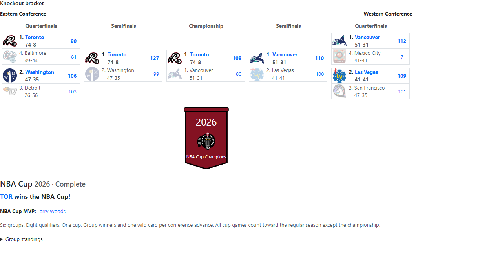
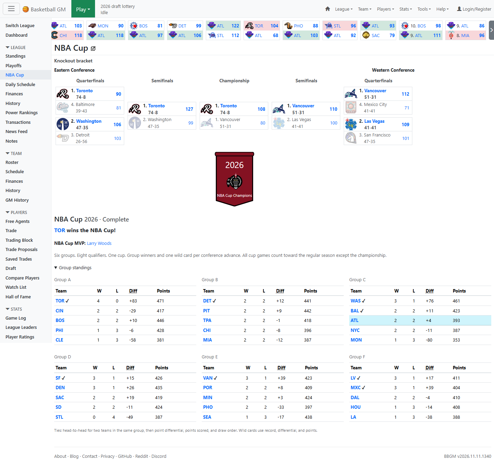
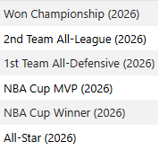
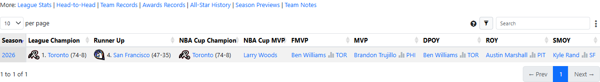

# NBA Cup mod for Basketball GM

An unofficial source-code mod that adds an in-season NBA Cup to Basketball GM: group play, a conference knockout bracket, a Cup MVP, and lasting player and team honors.



## Features

- **League → NBA Cup:** a dedicated page with group standings, qualifiers, a playoff-style bracket, scores, and box-score links.
- **Six groups and eight qualifiers:** three group winners and one wild card per conference advance to single-game quarterfinals, semifinals, and a neutral-site championship.
- **82 regular-season games:** knockout and consolation games preserve 82 counting games for every team. The finalists play an extra championship that is excluded from regular-season records and stats.
- **NBA Cup MVP:** selected from the champion's final roster by total Game Score across the tournament, including the final.
- **Player awards:** NBA Cup Winner and NBA Cup MVP honors on profiles and in season award columns.
- **Team and league history:** separate Cup win totals, banners, season labels, champion and MVP columns, and season-summary results.
- **Archived tournaments:** a season selector for past Cups. Cup titles are counted separately from league championships.

Screenshots use a simulated league with fictional teams and players.

## Run your own private copy

Install **Node.js 24** and **Git**. Node.js includes npm; the commands below use pnpm 12 through npm without requiring a global pnpm installation.

```sh
git clone --branch mods --single-branch https://github.com/IraqLobster34/zengm.git zengm-nba-cup
cd zengm-nba-cup
npx --yes pnpm@12 install
node --run dev
```

For a source ZIP, extract it and open a terminal in the folder containing `package.json`, then run the last two commands. An internet connection is needed for the first dependency installation.

Open the URL printed by the server, normally `http://localhost:3000`. Basketball is the default sport. Keep the terminal open while playing; press **Ctrl+C** to stop it.

**To see the Cup:** create a basketball league with **30 active teams, two conferences of 15, and 82 games**, advance from preseason to the regular season, and open **League → NBA Cup**. Existing regular seasons get their first Cup the next time a compatible season begins. Other sports and incompatible league sizes retain their normal schedules.

Saves live in your browser. Export backups of leagues you care about before trying a mod, and use a consistent browser and local address to return to the same saved leagues.

## Screenshots

### Group play



### Player awards



### League history



See the [full gallery](docs/SCREENSHOTS.md) for player profiles, team history, season summaries, and the narrow-screen layout.

## Adaptations and limitations

This adapts the NBA Cup to ZenGM's calendar and fictional leagues:

- The draw follows the NBA's five-pot system: each conference is ranked by the previous regular season, split into ranks 1–3, 4–6, 7–9, 10–12, and 13–15, and each group receives one randomly drawn team per pot. See the [official draw rules](https://cdn-uat.nba.com/news/nba-cup-frequently-asked-questions).
- If no prior-season results exist, the first draw is randomized. Teams individually missing history fill the remaining lowest-ranked slots in random order. The Cup page shows the pots and any fallback. Existing groups are not redrawn; this applies when the next Cup schedule is created.
- Group nights are interleaved with the first 20 schedule days, followed by a dedicated knockout window.
- Group tiebreaks use head-to-head for a two-team tie, point differential, points scored, and draw order. Wild-card/conference seeding use record, differential, points, and team ID as the final fallback. Scores include overtime.
- Non-qualifiers play a home-and-away consolation pair that may cross conferences.
- The schedule editor is unavailable until the Cup ends, protecting reserved tournament games.

This initial version does not add Cup prize money or an All-Tournament Team. Completed Cups from an older version can receive profile awards when opened if their saved box scores are still available.

## Development

```sh
node --run lint
node --run test
```

The Cup, schedule, award grouping, and route checks passed **35 tests**, with one upstream test skipped. TypeScript and lint checks on changed source files passed. Browser checks covered a full Cup and regular season, 82 counting games per team, profile awards, history screens, and the championship banner.

See [MODDING.md](MODDING.md) for implementation notes, [release notes](RELEASE_NOTES.md) for this mod, and the [original upstream README](README.upstream.md) for ZenGM's development and contribution documentation.

## License and credits

Basketball GM and ZenGM are created by **ZenGM, LLC**. This is an unofficial mod, not an official ZenGM or NBA release.

ZenGM is **not open source**. Its [original license](LICENSE.md) permits sharing modified source code with the license included and running a private local copy. It prohibits hosting a playable version for others or distributing playable installers. This fork shares source and local setup instructions under those terms; it does not provide a hosted game or installer.

Upstream: [zengm-games/zengm](https://github.com/zengm-games/zengm).
