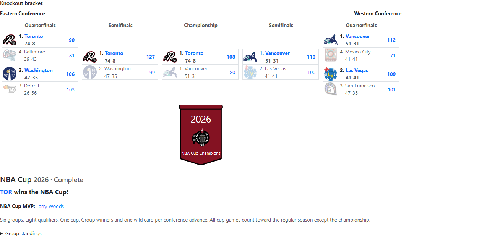
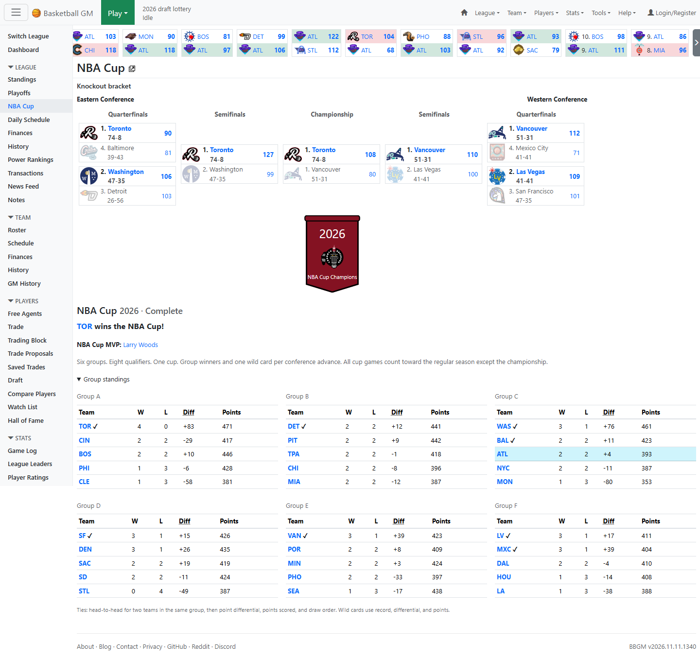
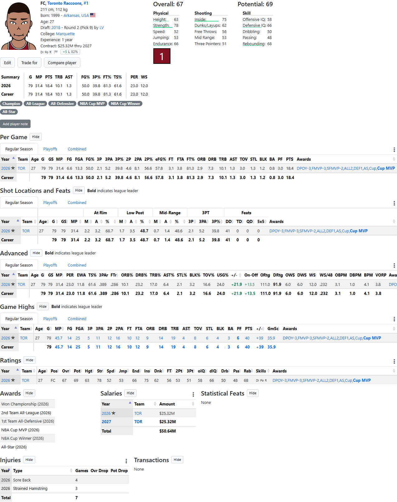
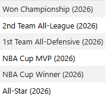
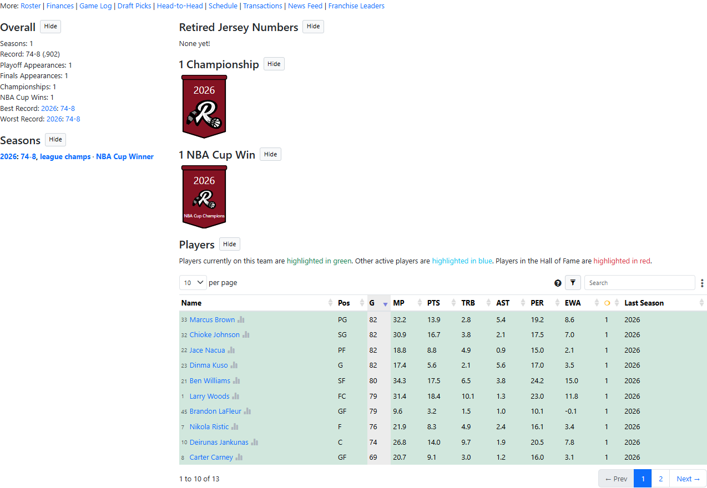
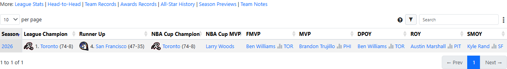
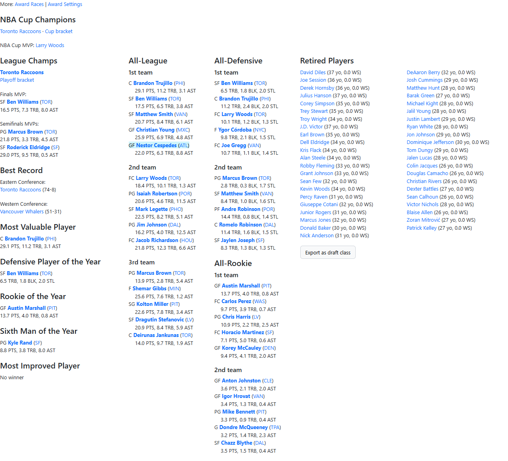
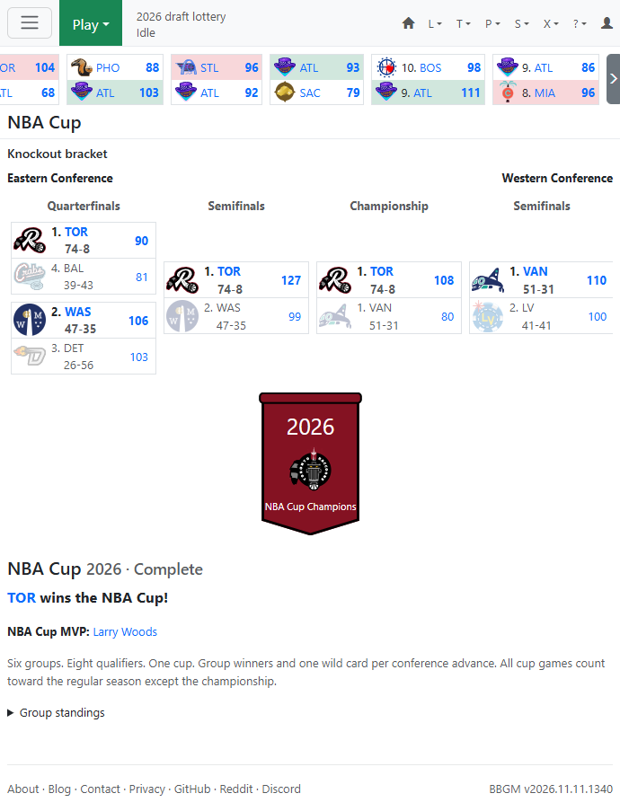

# Screenshot gallery

Actual screenshots of the mod running locally. The sample league uses fictional teams and players; names and results are illustrative. These images are not fabricated or composited.

## Cup bracket

The dedicated page, conference bracket, championship banner, champion, and MVP.

## Group standings

Six groups, qualification marks, records, point differential, and points.

## Player profile

Cup honors on the MVP's profile and in season award columns.

## Player awards detail

Winner and MVP honors saved with the season.

## Team history

Cup win totals, season labels, and banners separate from league titles.

## League history

Separate NBA Cup Champion and NBA Cup MVP columns.

## Season summary

Cup champions, MVP, and a link to the bracket.

## Narrow-screen layout

The bracket scrolls horizontally within its own container.

